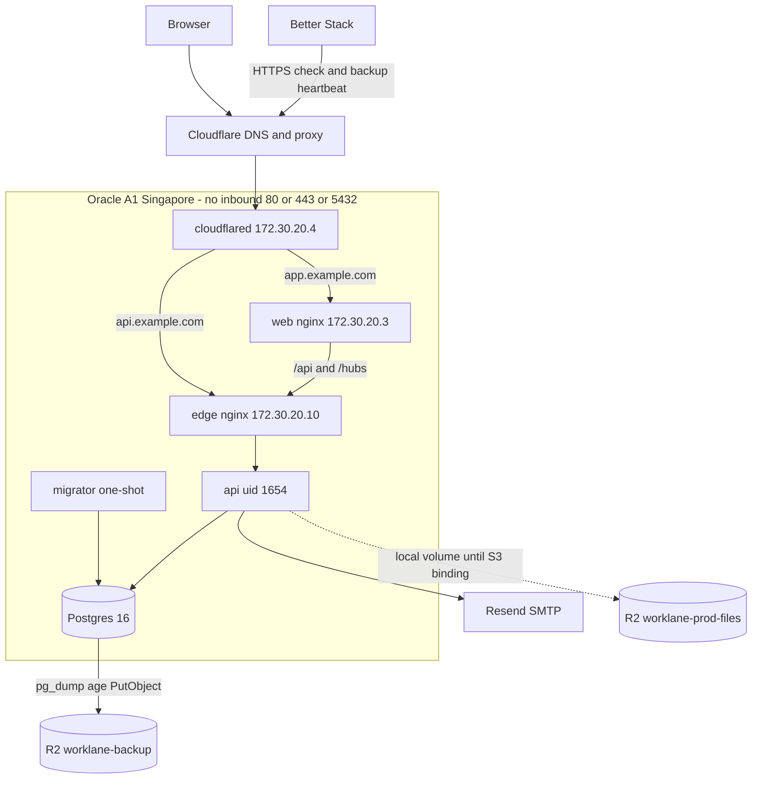

# Production deploy plan (draft)

**อ่านก่อน — ยังห้าม deploy**

Production deploy ถูกบล็อกจนกว่า **WL-63 (JWT rotation) จะ merge**. เอกสารนี้เป็นแผนและไฟล์ร่างเท่านั้น ยังไม่มีการสมัครบัญชี ไม่มี secret จริง ไม่มี tunnel จริง และไม่มี workflow deploy (D-33: ห้ามเพิ่มหรือแก้ `.github/workflows` เพื่อ deploy). เปิดเป็น draft PR เข้า `develop` เท่านั้น ห้าม merge.

**HARD GATE: do not deploy until WL-63 is merged.**

This repository still refuses a known-leaked signing key at startup (`JwtSigningKeys`). That check is not a substitute for the merged ticket. Phase 0 (accounts, the VM, R2) can be prepared after อรุษ approves it. Phase 1 (the first `docker compose up` that can be reached from the internet) waits for WL-63. The checklist dated 11 Nov 2026 also blocks a **public** deploy until WL-67 (PDPA / privacy notice) is done. WL-67 does not replace WL-63. Both are on the go/no-go list. WL-63 is first.

Nothing in `deploy/prod/` is a running system. Image digests are 64 copies of one hex digit. `docker compose pull` cannot resolve them. `deploy/prod/scripts/preflight.sh` exits 1 while those digests and `CHANGE_ME` values remain. That script does not query GitHub and is not the WL-63 control. PR #8's `WL63_DONE` file was the same kind of speed bump: a direct `docker compose up` never read it. This plan does not repeat that file.

## What this draft is

Target, from the 11 Nov 2026 accounts checklist:

- Oracle Cloud Always Free Ampere A1, home region **Singapore**, shape **2 OCPU / 12 GB**
- Cloudflare DNS and a Cloudflare Tunnel (no inbound 80/443)
- Cloudflare R2 for file storage and for backups (separate buckets, separate tokens)
- Resend for transactional mail
- Better Stack, Grafana Cloud, and Sentry for uptime, metrics/logs, and errors

The API on `develop` still stores attachments with `LocalFileStorage`. `FileStorageSettings` does not bind the S3 keys. R2 for **files** is an account and a bucket in Phase 0, not a code path this draft turns on. R2 for **Postgres dumps** is what `deploy/prod/backup/` implements.

`ASPNETCORE_ENVIRONMENT` in the compose file is the literal `Production`. An env file cannot flip it to Development, so the demo seeder cannot run. `--migrate-only` migrates and does not seed.

## Relationship to draft PR #8

Source: <https://github.com/arutdevs/Worklane-Api/pull/8>, branch `cursor/beta-arm64-deploy-f48a`, head `36c62d900be81f0492fac842e18ff894a683305a`. That PR is still an open draft. It was not merged. This plan does not merge it and does not copy it wholesale. `develop` has since gained `--migrate-only` on the API image and a real Data Protection key path. The separate `Worklane.Migrator` project from PR #8 is not on `develop`.

### Kept

- One ARM VM, Cloudflare Tunnel as the only ingress, Postgres unpublished.
- Split networks. `db` and `app` are internal. Postgres has no route to the internet. The API reaches Resend and the backup job reaches R2 on a separate `egress` network.
- The fixed proxy addresses the API already trusts: edge `172.30.20.10`, web `172.30.20.3`. Tunnel container is `172.30.20.4` so the edge can tell those peers apart.
- Container hardening that PR #8 required and that was re-checked here for Postgres: read-only root, `tmpfs` with `noexec,nosuid,nodev`, `cap_drop: [ALL]` plus a short `cap_add` for the database entrypoint, `no-new-privileges`, `pids_limit`, memory and CPU caps, `shm_size: 256mb`, json-file logs at 10m × 3.
- Data Protection keys at `/var/lib/worklane/dataprotection-keys` on a named volume. The process runs as uid 1654 and will not create that directory.
- The migrator does not bind-mount the repo and does not take a `--connection` argument. It uses `ConnectionStrings__Default`.
- `pg_dump -Fc`, optional age (gpg as a second choice), upload with the S3 API, a Better Stack heartbeat after success, a `pre-migration/` prefix, and a restore that stops the app and does not start it again.
- Secrets in `/etc/worklane/prod.env`, mode 600, outside the checkout. Nothing secret is committed.
- nginx-unprivileged, uid 101, port 8080. cloudflared's container healthcheck only proves the binary runs. Uptime on the public name is the tunnel check.
- Resend SMTP `smtp.resend.com:587`, username `resend`, From address still equal to the SMTP username because that is what `SmtpEmailService` sends.
- No object-storage container in this compose file. No Development overlay.

### Changed

- Files live under `deploy/prod/` and `docs/deploy/`. PR #8 used `deploy/beta/`.
- The migrator **is** the API image with `command: ["--migrate-only"]`. The API service waits for `service_completed_successfully`. The migrator mounts the key volume, because Production runs `AddWorklaneDataProtection` before `MigrateAsync` and refuses to start if the directory is missing or not writable.
- Digests are placeholders, not the October 2026 pins and not the `worklane-*:unlocked-do-not-run` tags. Those tags were not digests. The October pins are stale, and an amd64 digest taken on a build machine must not be copied onto this ARM host.
- Memory and CPU limits are literals. PR #8 allowed an env file to raise them past the 2 OCPU / 12 GB budget.
- Backup retention is **30 days** for every prefix. PR #8 used 35 / 91 / 365. The checklist caps beta backups at 30 days (WL-67). Revisit after beta (O-9). This draft does not keep a weekly or monthly copy past that cap.
- The tunnel sends `app.example.com` to web and `api.example.com` to the edge. PR #8 sent the tunnel only to web. The API on `develop` trusts a single proxy, `172.30.20.10`, and the Web nginx is explicitly not that proxy. Dropping the edge would collapse client addresses.
- `X-Forwarded-Proto` is `https`. The tunnel to origin is HTTP. `$scheme` would make `UseHttpsRedirection` loop.
- `deploy/prod/nginx/web.conf` is a contract for the Worklane-Web image. It is **not** bind-mounted. A mount would hide the SPA.
- Backup scripts do not source PR #8's `lib.sh`. They were run against a throwaway Postgres and a local S3 server (see Verification).
- A one-shot `volume-init` service (`chown 1654:1654` on the key and attachment volumes) runs before the migrator. The API image will not create those directories.
- `scripts/check-deploy-compose.sh` only auto-loads a sibling `.env.example`. This draft uses `.env.prod.example` and `${VAR:-default}` so `docker compose config` renders without that sibling. The defaults are `CHANGE_ME` and `example.com`. They are not a production configuration.

### Dropped, and why

| Dropped | Why |
|---|---|
| `.github/workflows/docker-image.yml` and any other deploy workflow | D-33. This ticket forbids workflow edits for deploy. The existing CI workflows are untouched. |
| dependabot entries for the beta compose | Not part of this ticket. Dependabot is unchanged. |
| `Worklane.Migrator` and its Dockerfile | Not on `develop`. `--migrate-only` is the migrator. |
| `check-compose.sh` (about 1,700 lines), `up.sh`, `images.lock.example`, `WL63_DONE` | The lock file and the done-file were bypassed by a direct compose up. Placeholders that cannot be pulled, plus the go/no-go list, are the draft's closed door. Re-introducing that checker would fork a second policy from the repo guard. |
| `WEB_COMMIT=8bf129286373546443b2804feb622bfa67d9c509` | That was the head of Worklane-Web PR #7, not a merged image digest. |
| `leaked-jwt-sha256.txt` | The fingerprint already lives in `JwtSigningKeys`. Do not copy key material into `deploy/`. |
| `init-db-roles.sh` (app / migrator / readonly roles) | `develop` still uses one database login. A second role is a schema change and is not in this draft. |
| `awscli` service with `network_mode: none` | A container that cannot dial out cannot upload. rclone runs in the backup script. |
| WAL-G / PITR | Not implemented on PR #8 either. Still a gap. Listed under TODO. |
| `sync-attachments-to-r2.sh` as a required job | The API does not write to R2 yet. A sync of the local volume would be a second source of truth. The volume is named so it survives a container recreate. Off-site file copies wait for the S3 binding. |
| Host crontab lines | Replaced by `worklane-backup.timer` (systemd) and the profiled `backup` service. No CI schedule. |
| October image digests, including any digest observed on this amd64 machine | Wrong architecture or stale. Pin linux/arm64 digests in the commit that replaces the placeholders. |

## Architecture

One VM. No inbound port except SSH, which is on the host, not in Compose. Docker bypasses ufw for published container ports; this compose publishes none, and the draft bootstrap adds a `DOCKER-USER` drop on the public NIC as defense in depth.



| Path | Who may connect | What the API sees |
|---|---|---|
| `app.example.com` | cloudflared → web → edge → api | Web adopts `CF-Connecting-IP` only from `172.30.20.4`, puts that single address in `X-Forwarded-For`, and clears the raw header. The edge adopts `X-Forwarded-For` only from `172.30.20.3`. |
| `api.example.com` | cloudflared → edge → api | The edge adopts `CF-Connecting-IP` only from `172.30.20.4`, then clears the raw header and sends one `X-Forwarded-For`. `server_name` is `api.example.com` until you edit it. |
| Anyone else | Not routed | `KnownProxies` is only `172.30.20.10`. There is no `KnownNetworks` entry. |

`ForwardLimit` stays 1. Do not add the Web nginx or cloudflared to `KnownProxies`.

Networks:

| Network | Internal | Members |
|---|---|---|
| `proxy` `172.30.20.0/24` | no (tunnel egress) | cloudflared `.4`, web `.3`, edge `.10` |
| `app` | yes | edge, api |
| `db` | yes | api, migrator, postgres, backup |
| `egress` | no | api (SMTP), backup (R2) |

One copy of this file per Docker host. A second project would try to use the same subnet.

### Resource budget (limits, not reservations)

Always on, summed: about 3.9 GiB and 1.40 CPU, inside 12 GiB and 2 OCPU. `shm_size` for Postgres is 256 MiB on top of its 2 GiB limit. The migrator runs before the API (the API waits for it), so those 1.5 GiB do not stack. The backup profile adds 512 MiB only while it runs.

| Service | Memory | CPUs | PIDs | Restart |
|---|---|---|---|---|
| postgres | 2g | 0.50 | 128 | unless-stopped |
| api | 1536m | 0.60 | 256 | unless-stopped |
| edge | 128m | 0.10 | 64 | unless-stopped |
| web | 128m | 0.10 | 64 | unless-stopped |
| cloudflared | 128m | 0.10 | 64 | unless-stopped |
| migrator | 1536m | 0.60 | 256 | no |
| volume-init | 64m | 0.05 | 32 | no |
| backup (profile) | 512m | 0.25 | 64 | no |

Leave the rest for the OS, dockerd, and page cache. Do not raise these from the env file.

Postgres `shared_buffers=512MB`, `max_connections=40`. The API pool is capped at 20.

## Phases

### Phase 0 — prepare, after อรุษ approves

No public DNS name pointing at the app. No `docker compose up` of this file. Accounts and the VM are อรุษ's to create:

1. Approve this free-tier stack (W-1) and buy the `.com`.
2. Cloudflare account, nameservers moved, R2 enabled. Buckets: `worklane-prod-files`, `worklane-staging-files`, `worklane-backup`. Location hint `apac`. Billing notice around 7 GB. Three tokens, see Secrets.
3. Oracle Cloud Always Free, home region Singapore, Pay As You Go, budget alert at $1. Do not pick another region (the home region is not a casual change). Do not generate fake load to avoid an idle reclaim.
4. Resend, domain verified, SPF/DKIM, DMARC `p=none` to start.
5. age keypair. Public recipient in the env file. Private key in a password manager **and** an offline copy. Not on Oracle. Not in Cloudflare. Not in git.
6. Better Stack, Grafana Cloud in Singapore (`ap-southeast-1`, cannot be moved), Sentry only after อรุษ confirms the region (D-74, the checklist suggests EU).
7. VM bootstrap: `deploy/prod/oracle-vm-cloud-init.draft.yaml` at create time, then `deploy/prod/oracle-vm-bootstrap.draft.sh` once the repo is on the disk. Both are drafts. They are not an IaC tool and they were not executed from this PR.

Phase 0 may create empty buckets and an empty VM. It may not serve the app.

### Phase 1 — first deploy, only after WL-63 is merged

Also still blocked for **inviting users** until WL-67 (privacy notice, controller named, W-5 / O-5). A closed smoke on the tunnel is not an invitation.

Order:

1. Confirm WL-63 is merged on `develop` and the image you are about to pin contains that commit. `preflight.sh` cannot do this. Look at the merge commit.
2. Build or promote **linux/arm64** images for the API (also the migrator), the Web app, and, if you use the in-cluster backup service, the backup image from `Dockerfile.draft`. Do not build them in a GitHub workflow as part of this ticket.
3. Replace every placeholder digest. See the upgrade section. `preflight.sh` must exit 0.
4. Install `/etc/worklane/prod.env` from `.env.prod.example`. Mode 600. Replace every `CHANGE_ME` and every `example.com`. `preflight.sh /etc/worklane/prod.env` must exit 0.
5. Edit `server_name` / hostnames in `deploy/prod/nginx/edge.conf` and `deploy/prod/cloudflared/config.yml` to the real names. Keep the three IPs.
6. Put the Web image's nginx in line with `deploy/prod/nginx/web.conf` (health URL, `/api/` and `/hubs/` to `172.30.20.10`, CF header handling). Do not bind-mount that file onto the Web container.
7. Apply the R2 lifecycle in `deploy/prod/backup/r2-lifecycle.example.json` with an admin token you do not leave on the VM.
8. Create the Cloudflare Tunnel. Either paste the ingress into the dashboard (token mode, which is what the compose service uses) or mount the config template plus a credentials file that stays on the VM.
9. First boot, from the VM, after the digests are real:

```bash
docker compose --env-file /etc/worklane/prod.env \
  -f deploy/prod/docker-compose.prod.yml up -d
```

`volume-init` chowns the volumes, Postgres becomes healthy, the migrator runs `--migrate-only` and exits 0, then the API, the edge, web, and cloudflared start. If the key volume is recreated later:

```bash
docker compose --env-file /etc/worklane/prod.env \
  -f deploy/prod/docker-compose.prod.yml up -d --force-recreate volume-init
```

10. Point the public hostnames at the tunnel. Check Better Stack. Run one backup and one restore drill **before** inviting anyone.
11. Install `worklane-backup.service` and `worklane-backup.timer` only after that drill succeeds. Paths in the unit assume the repo is at `/opt/worklane`.

There is still no deploy workflow. A human runs these commands.

## Upgrade and image pinning

Pin the **linux/arm64 manifest digest**, not a floating tag and not the multi-arch index unless you have confirmed the index resolves to that arm64 manifest. The compose file also sets `platform: linux/arm64`.

On a machine that can see the registry:

```bash
docker buildx imagetools inspect NAME:TAG
```

Record the arm64 digest in the PR that replaces the placeholder. The image line stays a literal `name:tag@sha256:…` with no `$`. `scripts/check-deploy-compose.sh` fails the file if any `services.*.image` contains a dollar sign.

Placeholder pattern (rejected by preflight): `sha256:` plus the same hex digit 64 times.

| Service | Placeholder image | Replace with |
|---|---|---|
| postgres, volume-init | `postgres:16-alpine@sha256:1111…` | The arm64 digest of `postgres:16-alpine` you scanned. Both lines together. |
| api, migrator | `ghcr.io/arutdevs/worklane-api:prod@sha256:2222…` | The API image built from the WL-63 commit. Same digest on both services. |
| web | `ghcr.io/arutdevs/worklane-web:prod@sha256:3333…` | The Worklane-Web image. nginx-unprivileged, uid 101, port 8080, contract in `nginx/web.conf`. |
| edge | `nginxinc/nginx-unprivileged:1.28-alpine@sha256:4444…` | The arm64 digest of that tag. Do not copy an amd64 inspect. |
| cloudflared | `cloudflare/cloudflared:2026.10.1@sha256:5555…` | The arm64 digest of the tag you actually reviewed. Confirm the entrypoint is still `cloudflared` and the command `tunnel run` reads `TUNNEL_TOKEN`. |
| backup | `ghcr.io/arutdevs/worklane-backup:prod@sha256:6666…` | Only if you use the profile. Build `Dockerfile.draft` on the VM. The systemd path does not need this image. |

An upgrade is:

1. `backup.sh /etc/worklane/prod.env pre-migration` and confirm `BACKUP_OBJECT=`.
2. Pin the new digests in the compose file. Do not `docker compose pull` a tag.
3. `docker compose --env-file /etc/worklane/prod.env -f deploy/prod/docker-compose.prod.yml up -d`.
4. The migrator runs again because its image digest changed. It applies pending migrations and exits. The API comes back only if that exit is 0.
5. Watch Better Stack. If the new app is bad and the migration was expand-only, roll the image back (next section). If the migration contracted, restore the dump.

Do not deploy by retagging `:latest` or `:prod` without a digest.

## Database migration

The migrator command is `dotnet Worklane.WebApi.dll --migrate-only` (the image entrypoint plus `command`). That calls `Database.MigrateAsync()` and returns. There is no down command. Production does not migrate inside the long-running API process.

Before the first migration of a non-empty database, and before every later migration:

```bash
/opt/worklane/deploy/prod/backup/backup.sh /etc/worklane/prod.env pre-migration
```

The key directory must already exist and be writable by uid 1654:

`DataProtection__KeysPath=/var/lib/worklane/dataprotection-keys`

`volume-init` does the chown. The API and the migrator both mount the named volume `dpkeys`. Losing that volume makes existing Data Protection payloads (password-reset tokens and anything else protected with that ring) unreadable. Back it up with the VM disk snapshot you take by hand before a risky change. It is not inside the `pg_dump`.

The JWT key and `Frontend__BaseUrl` are validated **before** migrate. A bad key blocks the migration. That is intentional.

### Expand / contract

Ship schema in two releases when a change would break the previous image.

| Release | Database | App |
|---|---|---|
| N (expand) | Add nullable columns, new tables, new indexes. Do not drop or rename anything the running app reads. | Old and new images both start. |
| N+1 (contract) | Drop or rename only after the image that still reads the old shape is gone. | This image is the first that depends on the new shape. |

`pg_restore` of the pre-migration dump is the rollback for a contract, not `ef migrations` down. Do not contract in the same release that stops writing the old shape.

A restore onto a database that already has objects needs `restore.sh <key> --yes --clean`. `--clean` is `pg_restore --clean --if-exists`. Without `--clean`, a non-empty database is left as it is and the script exits 1.

## Rollback

App image, when the migration was expand-only:

1. Put the previous **digest** back on `api`, `migrator`, and `web` as required.
2. `docker compose up -d` with the prod env file.
3. Do not restore the database. A down migration is not available and is the wrong tool while the new columns are unused.

App plus database, when the migration contracted or the new app corrupted data:

1. `docker compose stop api web edge` (restore.sh does this when `WORKLANE_COMPOSE_FILE` is set).
2. Leave Postgres running.
3. `restore.sh /etc/worklane/prod.env <BACKUP_OBJECT> --yes --clean`
4. Confirm a row you know. The script does not start api, web, or edge.
5. Pin the previous app digest, then start those three services.
6. The Data Protection volume is not in the dump. If you also rolled that volume back, say so in the incident note. If you did not, tokens issued under the new ring may not decrypt. Prefer leaving the key volume in place unless the failure was the ring itself.

Take the `pre-migration` dump **before** the migrator runs, or you will restore a database that already contains the bad migration.

## Backup and restore drill

Daily path: `deploy/prod/backup/backup.sh`.

1. `pg_dump -Fc -Z 6` (custom format, compressed). That is the compression step. A second gzip is not applied.
2. `pg_restore -l` on the dump before encryption, so an empty or truncated dump is not uploaded.
3. age if `BACKUP_AGE_RECIPIENT` is set, else gpg if `BACKUP_GPG_RECIPIENT` is set, else fail. `BACKUP_ALLOW_UNENCRYPTED=1` is a drill switch and stays empty on the VM.
4. One PutObject via rclone's S3 API. Multipart stays available for R2. The local drill sets `R2_DISABLE_MULTIPART=1` because `rclone serve s3` mishandles multipart.
5. Object key: `daily/<project>/YYYY/MM/DD/<project>-YYYYMMDDTHHMMSSZ.dump.age` (or `pre-migration/…`).
6. Heartbeat only after the upload returns. On failure the script pings `<url>/fail` and does not print the URL.

The script does **not** delete objects. The daily token cannot `GetObject` or `DeleteObject`. Retention is the lifecycle file: 30 days on `daily/` and `pre-migration/`, abort incomplete multipart uploads after 7 days. Apply that lifecycle with a token you do not store on the VM.

Schedule, after the first drill:

- systemd: `deploy/prod/backup/worklane-backup.timer` at 18:15 UTC (01:15 Asia/Bangkok). The service uses `EnvironmentFile=/etc/worklane/prod.env` and runs the script on the host, with `WORKLANE_COMPOSE_FILE` so `pg_dump` runs inside the Postgres container. rclone must be installed on the host (the bootstrap draft installs it).
- Or, once the backup image digest is real: `docker compose --profile backup --env-file /etc/worklane/prod.env -f deploy/prod/docker-compose.prod.yml run --rm backup`

`docker compose up` without the profile does not start the backup service.

Restore:

```bash
deploy/prod/backup/restore.sh /etc/worklane/prod.env \
  'daily/worklane-prod/YYYY/MM/DD/worklane-prod-YYYYMMDDTHHMMSSZ.dump.age' \
  --yes
```

The restore token is a different key (`R2_RESTORE_*`). The script refuses to run if it equals the write token, unless `BACKUP_DRILL=1` (local only). The age identity file must be mode 600 and must not be a symlink.

Drill before the first user, and again after any change to this script:

1. Note a real row.
2. Run `backup.sh`.
3. On a **copy** of the volume, or in a maintenance window, `restore.sh … --yes --clean`.
4. Check the row.
5. Start api, web, and edge only after that check.
6. Confirm the Better Stack heartbeat fired, and that a failed run would hit `/fail` (try once with a bad endpoint in a scratch env, not in production).

The local proof in this PR (`deploy/prod/backup/smoke-drill.sh`) does steps 2–4 against throwaway containers. It is not a substitute for a drill against R2 and the age key you will actually store offline.

## Secrets

Least privilege. Nothing below is committed. `.env.prod.example` is placeholders (`CHANGE_ME`, `example.com`).

| Secret | Where it lives | What it can do |
|---|---|---|
| `JWT_SECRET` | `/etc/worklane/prod.env` only | Sign tokens. 32 bytes minimum after base64 decode. Must not be the burned dev key. |
| `POSTGRES_PASSWORD` | same file | One role, the image's bootstrap role. Quoted in the Npgsql string so a later base64 password can contain `=`. Do not put a single quote in the password. |
| `CLOUDFLARE_TUNNEL_TOKEN` | same file, env var, not the process argv | That one tunnel. Rotate by creating a new token and restarting cloudflared. |
| `R2_BACKUP_*` | same file, backup script only | `PutObject` on `worklane-backup` only. No `GetObject`, no `DeleteObject`, no access to the files bucket. |
| `R2_RESTORE_*` | not on the VM daily. Password manager. Put it in the env file only for a restore, then remove it. | `GetObject` and `ListBucket` on `worklane-backup` only. |
| Lifecycle admin | password manager, used once | `PutLifecycleConfiguration` on the backup bucket. Not the app token and not the daily token. |
| `R2_FILES_*` | reserved. The API does not read these variables today. | When the S3 binding exists: object read/write on `worklane-prod-files` only. Not the backup bucket. |
| age private key | password manager and an offline copy | Decrypt dumps. The VM holds it only if you accept that a VM compromise decrypts backups. Prefer to bring it in for a restore and remove it. The public recipient may sit in the env file. |
| Resend SMTP password | env file | Send mail as the verified domain. |
| Sentry DSN, Grafana token | named in the example, empty, not passed into the API container | The process does not load them yet. |

Do not put these in GitHub Actions for a deploy. There is no deploy workflow. If a later ticket adds one, it belongs in a repo that can require a reviewer, which D-21 already called out, and it is not this PR.

`gitleaks` scans history. Do not "fix" a finding by weakening `.gitleaks.toml`.

## Monitoring and alerting

What this draft can actually wire:

| Signal | How | Fires when |
|---|---|---|
| Uptime | Better Stack HTTPS monitor on `https://app.<domain>/` and `https://api.<domain>/` | The tunnel, Cloudflare, or the process is down. A 404 still means the process answered. There is no `/health` endpoint in the API. nginx answers `/nginx-health` inside the network only. |
| Backup | `BETTERSTACK_HEARTBEAT_URL` after a successful upload, `<url>/fail` on failure | The timer did not run, `pg_dump` failed, age failed, or the upload failed. |
| Pre-migration dump | `BETTERSTACK_HEARTBEAT_URL_PRE_MIGRATION` | Optional second heartbeat so a manual dump does not look like the daily one. |
| Host | Better Stack monitor on SSH is the wrong check (SSH is not the app). Use the HTTPS monitors. | |
| Logs | json-file on the VM, 10m × 3 per service | This is not Grafana. A collector that needs the Docker socket is out of this draft. Do not mount `docker.sock` into a sidecar. |
| Errors | Sentry | Not in the API. Empty `SENTRY_DSN` in the example is a reserved name, not a wired SDK. |
| Metrics | Grafana Cloud | No OpenTelemetry export in the API. The Singapore stack should be created in Phase 0 so the region is fixed, and the collector is a later change. |

Create the Better Stack monitors and the heartbeat **before** inviting users. Grafana and Sentry accounts can exist in Phase 0 without a DSN in the container.

Alert email goes to อรุษ. LINE is optional and does not block Phase 0.

## Cost

Figures are the 11 Nov 2026 checklist (USD, before tax). This plan does not re-quote vendors.

| Item | Choice | Beta cost | Limit that matters |
|---|---|---|---|
| Domain | Porkbun `.com` | about $11.81/year, about $0.98/month | First year was quoted at $10.81 on that date. Check again at purchase. |
| DNS, proxy, tunnel | Cloudflare Free | $0 | Nameservers must be Cloudflare's. |
| VM | Oracle A1 Singapore, 2 OCPU / 12 GB | $0 | A card is required. Budget alert $1. Idle reclaim is a real risk. Do not fake load. |
| Postgres | On that VM | $0 | No managed PITR. |
| R2 | Files + backups share the account quota | $0 inside 10 GB-month, then $0.015/GB-month | Class A 1 million, Class B 10 million, egress $0. Warn around 7 GB. Files and dumps share the 10 GB. |
| Mail | Resend Free | $0 | 3,000/month and 100/day. Over the daily cap, mail stops until 00:00 UTC. No overage bill. Pro was quoted at $20. |
| Uptime | Better Stack Free | $0 | 10 monitors, 10 heartbeats, 3 minute checks, 1 status page. |
| Metrics and logs | Grafana Cloud Free, Singapore | $0 | 50 GB logs, 10k series, 14 day retention. Region cannot be changed later. |
| Errors | Sentry Developer | $0 | 1 user, 5,000 errors/month, then events are dropped. Region is อรุษ's call. |
| Inbox | Cloudflare Email Routing, later | $0 | Not required to send invites. |
| Fallback | DigitalOcean, not this plan | about $60.95/month | The checklist's exit path around 25 users. |

Closed beta inside the free quotas is about **$0.98/month**, the domain. The card on the Oracle account is not a monthly charge if the budget holds.

## Risks

| Risk | What we do in this draft | What is still open |
|---|---|---|
| Deploy before WL-63 | Digests cannot be pulled. The plan and the preflight banner say the deploy is blocked. | A human can edit the digests. The go/no-go list is the control. |
| Public users before WL-67 | Called out as a second gate. | Privacy notice and the named controller. |
| Single VM | Accepted for the free tier. | No failover. Oracle can reclaim an idle A1. |
| Backups and files in one Cloudflare account | Separate buckets and tokens. | An account lock still takes both. A second provider (B2) is deferred by the checklist. |
| Attachments on local disk | Named volume, uid 1654. | A VM loss loses files. S3 binding is not in the API. |
| No PITR | Daily encrypted dump, 30 days. | WAL-G is TODO. A day's writes can be lost. |
| Data Protection volume | Named volume, chowned before start. | Not in `pg_dump`. Losing it breaks protected tokens. |
| Docker bypasses ufw | No published ports. Draft iptables `DOCKER-USER` drop. | The bootstrap was not executed here. Review it before running it. |
| Client IP spoofing | Only `.4` and `.3` are real_ip sources, and the raw CF header is cleared. | A compromised cloudflared can still present any client address. That is the trust boundary. |
| `UseHttpsRedirection` loop | Edge sets `X-Forwarded-Proto https`. | If a future proxy sends `http`, the API will redirect. |
| Resend daily cap | Documented. | Invites fail closed at 100/day with no warning email from us. |
| Placeholder web image | Fake digest, contract file not mounted. | The first real Web image must implement the contract or `/nginx-health` and `/api` will be wrong. |
| Sentry region | Not created by this PR. | D-74 is อรุษ's decision and cannot be moved later. |
| JWT in an env file | Mode 600, not in git, not in argv. | Root on the VM can read it. That is the free-tier trade. |
| Restore token left on the VM | The script refuses a token equal to the write key. | Someone can set `BACKUP_DRILL=1` and skip that check. Do not set that flag on the VM. |
| 30 day backup cap | Lifecycle and a hard check in `backup.sh`. | A legal hold longer than 30 days is out of beta and needs a new decision (O-9). |
| Guard filename gap (WL-71) | This file is named `docker-compose.prod.yml`, which the current guard selects. | WL-71 is not closed. A future `prod.yml` would still slip past the name match. |

## Go / no-go

All of these are required before the first public hostname serves the app. **WL-63 is a hard no if it is not merged.**

- [ ] **WL-63 is merged** and the API image digest was built from that commit or a later one. The leaked dev key is rejected by the process you are about to start.
- [ ] WL-67 / W-5: controller named, privacy notice reviewed, no real users invited before that. (Blocks invites even if the tunnel is up.)
- [ ] อรุษ approved the Phase 0 stack, the domain, the Singapore region, PAYG, and the $1 budget.
- [ ] `preflight.sh` exits 0 against the compose file **and** `/etc/worklane/prod.env`.
- [ ] Every image line is an arm64 digest. No `$` in an image line. No repeated-nibble digest.
- [ ] `docker compose config` for this file was read, and it publishes no ports.
- [ ] Edge is `172.30.20.10`, web is `172.30.20.3`, cloudflared is `172.30.20.4`. `KnownProxies` is only `.10`. No `KnownNetworks`.
- [ ] Web image implements `deploy/prod/nginx/web.conf` and the file is not bind-mounted over the SPA.
- [ ] `server_name` and the tunnel hostnames are the real domain, not `example.com`.
- [ ] R2 backup token is write-only and is not the files token. Restore token is different and is not left on the VM.
- [ ] age private key is in the password manager and offline, not only on the VM.
- [ ] Lifecycle is 30 days and has been applied.
- [ ] One backup and one restore drill succeeded, including a decrypted row check.
- [ ] Better Stack HTTPS monitors and the backup heartbeat exist, and the alert mail reaches อรุษ.
- [ ] Sentry region is decided before any DSN is set. Grafana, if created, is Singapore.
- [ ] Resend domain is verified. DMARC starts at `p=none`.
- [ ] ufw denies inbound except SSH. `DOCKER-USER` drops new flows from the public NIC.
- [ ] No file under `.github/workflows/` was added or edited for this deploy.
- [ ] `ASPNETCORE_ENVIRONMENT` is still the literal `Production` in the compose file.
- [ ] This PR stays a draft until อรุษ or the tech lead marks it ready. Merging the plan is not a deploy.

## Checks run while writing this draft

These are local checks, not a deploy. The ARM VM was not used. Postgres and nginx were the amd64 pulls of the same tags, with the same read-only root, capability drop, and tmpfs flags the compose file sets. Image digests in the compose file stayed placeholders.

- `docker compose -f deploy/prod/docker-compose.prod.yml --env-file deploy/prod/.env.prod.example config` exited 0. The rendered file has no `ports` and no published ports, including with `--profile '*'`.
- `shellcheck -x` on every script under `deploy/prod/` exited 0.
- `yamllint` (relaxed rules, line length 200) on the compose file, the tunnel template, and the cloud-init draft exited 0.
- `scripts/check-deploy-compose.sh` exited 0.
- `deploy/prod/scripts/preflight.sh deploy/prod/.env.prod.example` exited 1 because the placeholder digests and `CHANGE_ME` values are still there.
- Hardened `postgres:16-alpine` answered `pg_isready` and `select 1`.
- Hardened `nginxinc/nginx-unprivileged:1.28-alpine` with `deploy/prod/nginx/edge.conf` answered `/nginx-health` with `ok`, and `nginx -t` succeeded.
- `deploy/prod/backup/smoke-drill.sh` exited 0. It uploaded an `.dump.age` object to a local S3 server and restored the row `worklane-drill-ok`. No host port was published. MinIO's registry path was not pullable in that environment, so the server was `rclone serve s3`.

## TODO (not done in this draft)

- WAL-G or any PITR. Dumps only.
- API binding for R2 file storage, and a decision on whether the attachment volume is then a cache or is removed.
- A real `/health` that does not depend on a successful proxy to the API for the edge check (the edge has `/nginx-health`; the API does not).
- Sentry SDK and an OpenTelemetry exporter. Names are reserved in the env example and are not passed to the container.
- Separate database roles for the app, the migrator, and the dump. `develop` has one login.
- A second backup provider so a Cloudflare account failure does not take files and dumps together.
- Staging as a second compose project. It cannot share `172.30.20.0/24` on the same Docker host. It needs its own subnet and its own review of the trusted IPs, or its own VM.
- Building and scanning the arm64 images. Out of scope while D-33 holds, and blocked on WL-63 anyway.
- Executing the cloud-init draft or the bootstrap draft. They were not run here.
- Replacing placeholder digests. They are fake on purpose.

## Files

| Path | Role |
|---|---|
| `docs/deploy/PROD-DEPLOY-PLAN.md` | This plan. |
| `deploy/prod/docker-compose.prod.yml` | The stack. Placeholder digests. No ports. |
| `deploy/prod/.env.prod.example` | Placeholders only. Copy to `/etc/worklane/prod.env`. |
| `deploy/prod/cloudflared/config.yml` | Ingress template. Not mounted. |
| `deploy/prod/nginx/edge.conf` | Mounted into the edge container. |
| `deploy/prod/nginx/web.conf` | Contract for the Web image. Not mounted. |
| `deploy/prod/backup/backup.sh` | Dump, encrypt, upload. |
| `deploy/prod/backup/restore.sh` | Download, decrypt, restore. |
| `deploy/prod/backup/lib.sh` | Shared helpers. |
| `deploy/prod/backup/smoke-drill.sh` | Local proof. Not a schedule. |
| `deploy/prod/backup/r2-lifecycle.example.json` | 30 day retention. Apply by hand. |
| `deploy/prod/backup/Dockerfile.draft` | Backup image. Not built by Compose or CI. |
| `deploy/prod/backup/worklane-backup.service` | systemd oneshot. |
| `deploy/prod/backup/worklane-backup.timer` | 18:15 UTC. |
| `deploy/prod/scripts/preflight.sh` | Rejects placeholders. Does not decide WL-63. |
| `deploy/prod/oracle-vm-bootstrap.draft.sh` | Draft host script. Not an IaC tool. |
| `deploy/prod/oracle-vm-cloud-init.draft.yaml` | Draft cloud-init. Not applied. |
